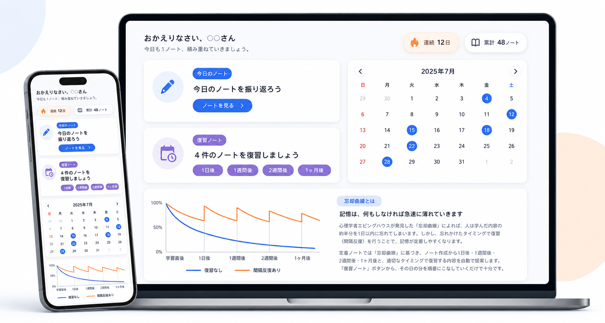

# 定着ノート（Teichaku Note）

学んだことを「1日1ノート」で記録し、忘却曲線に基づいた最適なタイミングで復習を提案する学習ノートアプリです。


## 公開URL

https://teichaku-web.onrender.com

※ 無料プランのため、初回アクセス時は起動に数十秒かかることがあります。

## アプリを作った理由

RUNTEQの学習では、日々の学習結果を日報・週報としてまとめ、各自がmattermost上で公開しています。
そこで、その成果物を定期的に読み返すことを自動化できれば、
効率的な復習手段として、学習内容を定着させやすくなるのではないか、と考えました。

また、Djangoに関する学習において、ログイン機能の実装や記事（各ページ）の作成・編集等を学んだため、
上記アプリならばこれらの学習成果を活かせると考え、制作に取り組みました。

## 主な機能

- **1日1ノートの記録**：1日1枚のノートに学習内容を記録します。
- **Markdownに対応したノート**：Markdown記法でノートに記述することが可能です。
- **間隔反復による復習提案**：作成から1日後・1週間後・2週間後・1ヶ月後に、復習するノートを1クリックで表示できます。
- **学習ダッシュボード**：連続学習日数、累計ノート数をダッシュボードに表示しています。
- **カレンダー機能**：カレンダーで学習状況を可視化しました。また任意の日付のノートを確認・編集できます。
- **ユーザー認証**：メールアドレスによりログイン・新規登録が可能です。

## 使用技術

| 分類 | 技術 |
|------|------|
| バックエンド | Python 3.14 / Django 5.2 |
| データベース | PostgreSQL 16 |
| フロントエンド | TailwindCSS v4 / daisyUI |
| 開発環境 | Docker / Docker Compose |
| デプロイ | Render / Gunicorn + Uvicorn / WhiteNoise |

## 工夫した点

- **ビューの責務分割**：ダッシュボードの機能が多いため、一度各機能を実装してからリファクタリングを行い、`DashboardView`の関数を分割して読みやすくしました。
- **ビューの内容**：views.pyのコードについて、RUNTEQで学習した内容（`get_context_data()`の活用など）やPythonの基本処理（カレンダー生成のforループなど）を盛り込めるように工夫しました。
- **共通コンポーネントの部品化**：忘却曲線カードなど、複数ページで使う要素を `` で共通化しました。
- **トップページの見せ方**：どんなアプリかを使用前によく理解してもらえるよう、トップページの説明を充実させました。
- **スマホ対応**：スマホからでも閲覧できるよう、HTMLの記載に配慮しました。

## 今後の改善ポイント
- ノートの削除機能の実装
- カレンダーの月切り替えにHTMXを導入し、非同期化（ページ全体の再読み込みを不要にしたい）

## ローカル環境での起動

```bash
# リポジトリをクローン
git clone https://github.com/ae-ohagi2428/teichaku_notebook.git
cd teichaku_notebook

# 環境変数ファイルを用意（.env）
# SECRET_KEY と POSTGRES_PASSWORD を設定

# Docker で起動
docker compose up -d

# マイグレーション
docker compose exec web python manage.py migrate
```

起動後、http://localhost:8000 にアクセスしてください。